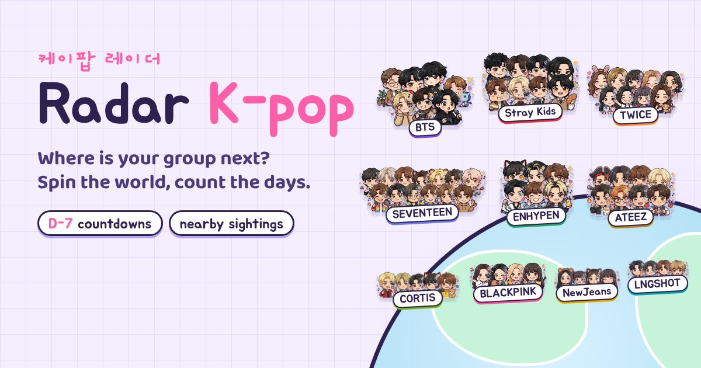

# Radar K-pop

[English](README.md) · **Español**



**¿Dónde tocan tus grupos favoritos y a cuántos kilómetros está de ti?**

Radar K-pop pone diez grupos en un pequeño globo 3D, cada uno dibujado como chibis parados en su próxima parada de gira. Ves la cuenta regresiva, la distancia hasta ti y un mapa pastel del barrio del recinto. Es un álbum de stickers que da gusto abrir cada día.

En vivo en [radar-kpop.vercel.app](https://radar-kpop.vercel.app).

## Los grupos

<table>
<tr><td align="center" width="33%"><br><b>BTS</b><br><sub>ARMY</sub></td><td align="center" width="33%"><br><b>Stray Kids</b><br><sub>STAY</sub></td><td align="center" width="33%"><br><b>TWICE</b><br><sub>ONCE</sub></td></tr>
<tr><td align="center" width="33%"><br><b>BLACKPINK</b><br><sub>BLINK</sub></td><td align="center" width="33%"><br><b>LNGSHOT</b><br><sub>SHOTTIES</sub></td><td align="center" width="33%"><br><b>SEVENTEEN</b><br><sub>CARAT</sub></td></tr>
<tr><td align="center" width="33%"><br><b>ENHYPEN</b><br><sub>ENGENE</sub></td><td align="center" width="33%"><br><b>NewJeans</b><br><sub>Bunnies</sub></td><td align="center" width="33%"><br><b>CORTIS</b><br><sub>COER</sub></td></tr>
<tr><td align="center" width="33%"><br><b>ATEEZ</b><br><sub>ATINY</sub></td><td></td><td></td></tr>
</table>

## Qué encuentras

- **Un globo para jugar.** Gíralo, haz zoom con los dedos, céntralo en ti. Se queda donde lo dejes.
- **68 chibis hechos a mano.** Cada integrante actual tiene su sticker con sus propios objetos, como el corazón de Jin o las patas de tigre de Hoshi. Tócalo y salta y dice su nombre en hangul.
- **Una tarjeta por grupo.** Cuenta regresiva grande, kilómetros hasta ti, la gira completa, la foto oficial, enlaces de música y un sticker de venta de entradas. Con un toque guardas el show en tu calendario.
- **Páginas de integrantes.** Perfiles con cumpleaños, cuentas oficiales y los últimos TikToks. Los cumpleaños traen banner, torta y confeti. Quienes están en servicio militar aparecen en gris y vuelven a color el día de su regreso.
- **Tu bias, tus grupos.** Dale corazón a los grupos que sigues y pasan al frente. Elige un bias y se queda con el lugar grande en tu tarjeta para compartir.
- **Lightsticks.** Cada lightstick oficial está dibujado a mano. Tócalo para encenderlo, uno a la vez, como en un estadio.
- **Modo concierto.** Un tema oscuro para noche de show, con globo nocturno, mapa de ciudad iluminado y un mar de lightsticks del color que elegiste.
- **Viene a tu país.** Cuando una gira para a menos de 600 km de ti, la tarjeta te avisa y cuenta los días hasta ese show.
- **Alertas.** Fechas nuevas, lanzamientos y avistamientos te llegan por temas gratis de ntfy o por un foro de Discord, con confeti en la página. Sin cuenta y sin datos personales.
- **Avistamientos cercanos, noticias y lanzamientos.** Posts oficiales que mencionan una ciudad, música y videos recientes, y noticias traducidas automáticamente con el original a un toque.
- **Hecho para el celular.** Tarjetas de grupo deslizables, PWA instalable, inglés y español, sonidos suaves que puedes silenciar, y respeta `prefers-reduced-motion`.
- **Modo video.** Un recorrido limpio en 9:16 de unos 15 segundos, pensado para grabar la pantalla.

## Pruébalo en 30 segundos

- [Abre el radar](https://radar-kpop.vercel.app/) y toca **Usar mi ubicación** para ver quién te queda más cerca.
- Salta directo a un grupo: [BTS](https://radar-kpop.vercel.app/?pick=bts), [Stray Kids](https://radar-kpop.vercel.app/?pick=skz), [TWICE](https://radar-kpop.vercel.app/?pick=twice).
- Mira la [vista sonar](https://radar-kpop.vercel.app/?view=sonar) con todos los grupos a tu alrededor.
- Prueba el [modo video](https://radar-kpop.vercel.app/?demo=video), un recorrido de 15 segundos pensado para grabar la pantalla.
- Cambia el idioma con `?lang=en` o `?lang=es`.

## Por qué existe

Las fechas de gira están regadas entre posts de las agencias, sitios de boletas y cuentas de fans. Quería una sola página que dijera dónde están después, qué tan lejos queda de mí y cuántos días faltan, y que fuera lo bastante divertida para compartirla.

Solo usa calendarios y posts públicos y oficiales. Muestra el próximo show confirmado, no dónde está alguien ahora mismo. Todo es a nivel de ciudad: sin avistamientos en aeropuertos y sin rastrear personas.

## Stack

HTML, CSS y JavaScript puros, sin framework y sin `npm install`. El globo es un canvas dibujado con d3-geo, los chibis son stickers SVG y WebP en el DOM, y los mapas de ciudad usan MapLibre con teselas de OpenFreeMap. Scripts en Python traen y combinan los datos, y un paso de build en Python los mete en un solo `index.html`. Se despliega en Vercel, funciona como PWA instalable con service worker y guarda las suscripciones a alertas en un Cloudflare Worker pequeño.

Un poco más de detalle:

- **Datos.** Un archivo curado de giras más Ticketmaster, iTunes, YouTube, kworb.net, posts oficiales en X y TikTok, y feeds RSS de noticias.
- **Actualizaciones.** Una GitHub Action corre cada 15 minutos, actualiza todo, envía alertas (ntfy, Discord) y reconstruye la página. Cada paso falla con suavidad.
- **Claves.** La configuración está en [CLAVES.md](CLAVES.md); los canales de alerta en [ALERTAS.md](ALERTAS.md).

```bash
python build.py               # genera index.html
python -m http.server 8000    # abre http://localhost:8000
```

Parámetros de prueba: `?now=2026-10-16T12:00:00Z`, `?pick=bts`, `?view=sonar`, `?lang=en`, `?demo=alert`, `?demo=video`. Los chibis se recortan de las hojas de stickers en `tools/art/` con `python tools/chibis_images.py`.

Hecho con cariño de fan por [Cristian Pérez](https://cristianperez.me).
