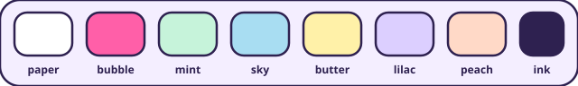

# Radar K-pop


**Where are your favorite groups playing next, and how far is it from you?**

Radar K-pop puts ten groups on a small 3D globe, each one drawn as chibis standing on its next tour stop. You get a countdown, the distance to you and a pastel map of the venue's neighborhood. It's a sticker book you can open every day.

Live at [radar-kpop.vercel.app](https://radar-kpop.vercel.app).

## The groups

<table>
<tr><td align="center" width="33%"><br><b>BTS</b><br><sub>ARMY</sub></td><td align="center" width="33%"><br><b>Stray Kids</b><br><sub>STAY</sub></td><td align="center" width="33%"><br><b>TWICE</b><br><sub>ONCE</sub></td></tr>
<tr><td align="center" width="33%"><br><b>BLACKPINK</b><br><sub>BLINK</sub></td><td align="center" width="33%"><br><b>LNGSHOT</b><br><sub>SHOTTIES</sub></td><td align="center" width="33%"><br><b>SEVENTEEN</b><br><sub>CARAT</sub></td></tr>
<tr><td align="center" width="33%"><br><b>ENHYPEN</b><br><sub>ENGENE</sub></td><td align="center" width="33%"><br><b>NewJeans</b><br><sub>Bunnies</sub></td><td align="center" width="33%"><br><b>CORTIS</b><br><sub>COER</sub></td></tr>
<tr><td align="center" width="33%"><br><b>ATEEZ</b><br><sub>ATINY</sub></td><td></td><td></td></tr>
</table>

## What you get

- **A globe you can play with.** Spin it, pinch it, center it on yourself. It stays where you leave it.
- **68 hand-made chibis.** Every current member has a sticker with their own props, like Jin's heart or Hoshi's tiger paws. Tap one and it hops and says its name in Hangul.
- **A card per group.** Big countdown, kilometers from you, the full tour, the official photo, music links and a ticket on-sale sticker. One tap saves the show to your calendar.
- **Member pages.** Profiles with birthdays, official accounts and latest TikToks. Birthdays get a banner, a cake and confetti. Members in military service show up in grey and come back in color on their return date.
- **Your bias, your groups.** Heart the groups you follow and they go first. Pick a bias and it gets the big spot on your shareable story card.
- **Lightsticks.** Each official lightstick is drawn by hand. Tap to light it up, one at a time, like in a stadium.
- **Concert mode.** A show-night dark theme with a night globe, a lit city map and a sea of lightsticks in the color you picked.
- **Coming to your country.** When a tour stops within 600 km of you, the card tells you and counts down to that show.
- **Alerts.** New dates, releases and sightings reach you through free ntfy topics or a Discord forum, with confetti in the page. No account, no personal data.
- **Nearby sightings, news and releases.** Official posts that mention a city, fresh music and videos, and news auto-translated with the original one tap away.
- **Made for phones.** Swipeable group cards, an installable PWA, English and Spanish, small sounds you can mute, and `prefers-reduced-motion` respected.
- **Video mode.** A clean 9:16 tour of about 15 seconds, made for screen recording.

## The look

Pastel lilac paper, thick ink outlines and sticker shadows that sit a few pixels off the edge. Rounded type (Jua and Baloo 2, with Gaegu for handwritten notes), bouncy animations, and one color per group.



| Group | Color |
|---|---|
| BTS | `#7B3FE4` |
| Stray Kids | `#E5323B` |
| TWICE | `#FF8A2B` |
| BLACKPINK | `#F2559A` |
| LNGSHOT | `#0FA3B1` |
| SEVENTEEN | `#6C7BE8` |
| ENHYPEN | `#22A36A` |
| NewJeans | `#F2B705` |
| CORTIS | `#7CB518` |
| ATEEZ | `#C08A1E` |

## Why it exists

Tour dates are scattered across label posts, ticket sites and fan accounts. I wanted one page that says where they are next, how far that is from me and how many days are left, and that is fun enough to share.

It only uses public, official schedules and posts. It shows the next confirmed show, not where anyone is right now. Everything is at city level: no airport sightings, no tracking of people.

## Under the hood

The data comes from a curated tour file plus Ticketmaster, iTunes, YouTube, kworb.net, official posts on X and TikTok, news RSS feeds and OpenFreeMap tiles. A GitHub Action runs every 15 minutes, refreshes everything, sends alerts and rebuilds the page. Each step fails softly. Key setup is in [CLAVES.md](CLAVES.md) (Spanish) and alert channels in [ALERTAS.md](ALERTAS.md).

There's no framework and no npm install:

```bash
python build.py               # builds index.html
python -m http.server 8000    # open http://localhost:8000
```

Test parameters: `?now=2026-10-16T12:00:00Z`, `?pick=bts`, `?view=sonar`, `?lang=en`, `?demo=alert`, `?demo=video`. Chibis are cut from the sticker sheets in `tools/art/` with `python tools/chibis_images.py`.

Made with fan love by [Cristian Pérez](https://cristianperez.me).
